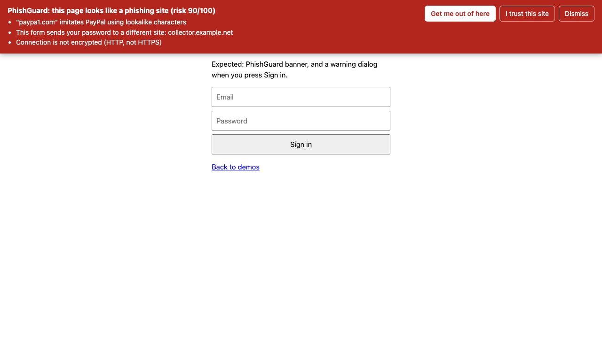
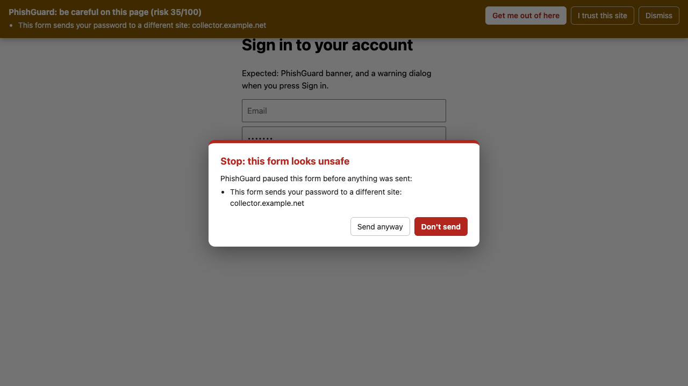

# PhishGuard: Real-Time Phishing Detection Extension


A Chrome extension (Manifest V3) that inspects every page you load and warns you **before** you
type your password into a phishing site.



## What it detects

| Detector | Example | How |
| --- | --- | --- |
| **Lookalike domains** | `paypa1.com`, `g00gle.com`, `arnazon.com` | Maps lookalike characters (`1→l`, `0→o`, `rn→m`) back to letters and compares against a list of commonly impersonated brands |
| **Unicode / IDN homographs** | `pаypal.com` (Cyrillic "а") | Decodes Punycode (`xn--…`) with a hand-written RFC 3492 decoder, then normalizes Cyrillic/Greek lookalikes |
| **Typosquats** | `microsofft.com`, `linkdein.com` | Damerau-Levenshtein edit distance of 1 from a brand name |
| **Brand-in-subdomain** | `paypal.com.secure-check.xyz` | Brand appears in the subdomain while the real registrable domain is something else |
| **Credential forms posting off-site** | Password form on `site-a` that submits to `site-b` | Inspects every form with a password or card field; compares the form's target domain to the page's |
| **Insecure credential forms** | Password sent over `http://` or by `mailto:` | Form action scheme checks |
| **Suspicious redirects** | `bit.ly → tracker → evil.xyz → login page` | Background worker records server **and** client (meta-refresh/JS) redirect chains per tab |
| **URL tricks** | `https://paypal.com@evil.example`, raw IP hosts, `?next=https://evil…` | URL parsing heuristics |

Each signal has a weight. Weights add up to a 0–100 risk score:
**≥ 60 = danger** (red banner), **≥ 30 = suspicious** (amber banner).

### It stops the submit, not just warns

If you press "Sign in" on a risky form, PhishGuard pauses the submission and asks you first.
It also re-checks at submit time, because phishing kits often swap the form's target with
JavaScript after the page loads.



## Install (developer mode)

1. Clone this repo.
2. Open `chrome://extensions` and switch on **Developer mode** (top right).
3. Click **Load unpacked** and pick this folder (the one with `manifest.json`).
4. Pin PhishGuard to the toolbar. The badge shows `!` (danger) or `?` (suspicious).

Works in Chrome, Edge, Brave and other Chromium browsers.

## Try it safely

```bash
cd demo
python3 -m http.server 8765
```

Open <http://localhost:8765>. The demo pages trigger the form detectors without sending data
anywhere (all "attacker" endpoints use `example.net`, a domain reserved for documentation).

URL detectors are skipped on `localhost`. To see a lookalike domain in action, point a fake
domain at your machine:

```bash
echo "127.0.0.1 paypa1.com" | sudo tee -a /etc/hosts
```

Then open `http://paypa1.com:8765/fake-login-external.html`. Remove the line from `/etc/hosts` when
you're done.

## Run the tests

```bash
npm test
```

The detection engine (`src/lib/detectors.js`) is pure JavaScript with no browser APIs, so it's
unit-tested in Node with the built-in test runner. No `npm install` needed.

## Architecture

```
manifest.json
src/
  lib/detectors.js   Detection engine: pure functions, shared by every part below + tests
  content.js         Runs in each page: scans URL + forms, shows the banner, guards submits
  background.js      Service worker: redirect-chain tracking, scoring, badge, allowlist
  popup/             Toolbar popup: score, findings, redirect chain, "trust this site"
tests/               Node unit tests for the engine
demo/                Safe local pages that trigger the detectors
```

```
page loads ──► background records redirect chain (webRequest + webNavigation)
          └──► content script analyzes URL + forms ──► background adds redirect findings,
                                                       scores, sets badge ──► banner if risky
user submits risky form ──► content script pauses it ──► user decides
```

### Security decisions in the extension itself

A security tool shouldn't open new holes, so:

- **Closed shadow DOM** for all injected UI: page scripts can't read or restyle the warning.
- **`event.isTrusted` checks** on every button: a malicious page can't click "I trust this site"
  for you.
- **`textContent`, never `innerHTML`**: hostnames and URLs are attacker-controlled, so they're
  never parsed as HTML.
- **`getAttribute("action")`, not `form.action`**: an `<input name="action">` can "clobber"
  `form.action` and hide where the form really posts.
- **`sender.url` from Chrome**, not a URL the content script reports, is what gets scored and
  allowlisted.
- **No remote calls**: all analysis is local. No browsing data leaves the machine.

## Limitations (and what to build next)

Known gaps, which double as a roadmap:

- [ ] Brand list is hard-coded (~25 brands). Load a bigger list, or let users add their own banks.
- [ ] Registrable domain uses a short suffix list. Use the full [Public Suffix List](https://publicsuffix.org).
- [ ] Logins that submit with `fetch()` instead of a `<form>` aren't intercepted.
- [ ] No threat-intel lookup. Add an optional check against Google Safe Browsing or PhishTank.
- [ ] No domain-age signal. Brand-new domains are a strong phishing indicator (RDAP lookup).
- [ ] Visual similarity: compare page favicon/logo against known brands.
- [ ] Firefox build (`browser.*` APIs, `background.scripts`).
- [ ] Tune weights against a real dataset (e.g. [OpenPhish](https://openphish.com) feed vs. Tranco top sites) and publish precision/recall.

## Disclaimer

Educational project. It's a heuristic layer, not a replacement for your browser's built-in Safe
Browsing protection or a password manager (which also won't autofill on lookalike domains).

## License

[MIT](LICENSE)
